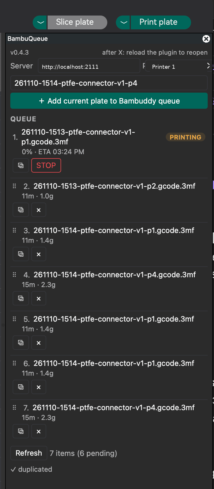

# BambuQueue

BambuQueue is an OrcaSlicer panel plugin for the PlateCycler C1 Auto Plate
Changer on the Bambu Lab A1 Mini. It sends each sliced plate to a local
[Bambuddy](https://github.com/maziggy/bambuddy) print server as its own job.
Bambuddy prints the plates one by one, and the PlateCycler swaps plates
between jobs. Nothing leaves your network.

## Why
Orca's own send button uploads the whole project at once, so Bambuddy cannot
run plate 3 by itself. BambuQueue queues one job per plate. The swap G-code
runs after each plate, you can reprint or cancel a single plate, and a stopped
print still ejects so the queue continues.

## Features
- One click after slicing. The plugin wraps the plate into the .gcode.3mf
  container Bambuddy requires, uploads it, and queues it with G-code
  injection on.
- Auto-capture. The plugin finds the newest finished slice in Orca's working
  directories. No preset setup, and no Send-button hack.
- Real per-plate stats. It reads time and grams from the gcode and rewrites
  slice_info.config, so Bambuddy shows real numbers for every job.
- Live panel. Drag to reorder pending jobs, copy, delete. The printing row
  shows progress and an ETA that updates every second.
- Stop with eject. STOP queues a release job behind the print, then aborts
  it. The eject runs next and the following plate starts on its own. Needs
  release.3mf, see below.

## Requirements
- OrcaSlicer 2.5.0 or newer. Verified on macOS. Windows and Linux capture
  paths are implemented but not tested.
- Bambuddy on the same network, with your A1 Mini registered. The plugin
  uses the plain LAN API and has no API-key support, so keep it on a
  trusted network.
- PlateCycler C1 on the A1 Mini. Its swap end-G-code goes in Bambuddy under
  Settings, G-code snippets, for your printer model.

## Install
1. Copy the `bambuddy_queue` folder into Orca's plugin directory. On macOS
   that is `~/Library/Application Support/OrcaSlicer/orca_plugins/`. On other
   systems follow the OrcaSlicer plugin docs for the path.
2. Restart OrcaSlicer. Plugins load at startup only.
3. In the BambuQueue panel, set your Bambuddy URL, for example
   `http://<bambuddy-host>:2111`. The first active printer is selected for
   you.
4. Slice a plate and press Add. The job appears in the Bambuddy queue.
5. Put your swap G-code in the `end_gcode` snippet for the printer model in
   Bambuddy settings. The plugin injects it before `; EXECUTABLE_BLOCK_END`
   on every queued plate.

Files in this folder:

| File | Purpose |
|---|---|
| bambuddy_queue.py | the plugin, stdlib only |
| template.3mf | upload container; its preview PNG is the queue thumbnail, so replace it with any Orca export you like |
| release.3mf / release.gcode | the stop-eject job; specific to one machine, read the safety section |

## How it works
Capture. Orca writes each slice to its own working directory under your temp
folder. The panel scans those directories every few seconds and stages the
newest completed slice, plus the sliced project file and the source model
name. Pressing Add forces one more check, so a slice that just finished is
never missed.

Packaging. Bambuddy rejects raw .gcode, so the plugin drops the plate gcode
into template.3mf, re-signs its md5, overlays the real project file, and
rewrites slice_info.config with the parsed estimates. Time comes from the
gcode header. Grams come from the extrusion moves times filament volume,
with a density constant of 1.27 g/cm3, so they are close, not exact.

Stop-eject. An abort kills the running job, so the swap at the end of the
gcode never runs. Bambuddy would then dispatch the next plate onto the bed
that still holds the failed print. STOP avoids this: it queues the release
job, places it directly behind the printing item, then aborts. The scheduler
runs the release job next. It lifts, parks, plays the done sound, releases
the plate, and extrudes nothing. After that the queue returns to normal.
Keep Bambuddy's `require_plate_clear` setting off, or the queue waits for a
manual click after every stop.

## Panel
| Control | Behavior |
|---|---|
| Server / Printer | Bambuddy URL and printer, printer auto-selects |
| Name | prefills as `YYMMDD-HHMM-project-pN` per new slice; edit it; your edits survive refresh |
| Add | stages the newest slice, uploads, queues |
| Queue list | drag the grip to reorder pending jobs; copy and delete buttons; the printing row shows a badge, percent, live ETA, copy, and STOP |

Closing the panel with its X button destroys it; reload the plugin (or
restart OrcaSlicer) to reopen it. There is no reopen hook in the Orca plugin
API.

Settings persist in `<Orca data dir>/bambuddy_queue/config.json`.

## release.3mf safety
The included `release.3mf` fits one machine only: a Bambu A1 Mini with a
PlateCycler C1. It contains the stock A1 Mini end block, including `M177`
and `M1006` sound lines, plus the PlateCycler C1 swap motion. Other
printers or rigs must rebuild it: take the header and end block from a
real slice of your machine, append your own swap motion, and package it
like a plate. If the motions can hit your hardware, run it over a cleared
bed first. Delete `release.3mf` to disable eject-on-stop; STOP then
behaves like Bambuddy's own stop.

## Troubleshooting
- Add does nothing: restart OrcaSlicer after plugin updates, and check that
  a slice actually finished.
- 404 or 405 from the API: Bambuddy routes need a trailing slash, like
  `/api/v1/queue/`.
- Every job shows the same stats: your template.3mf kept old estimates; use
  plugin 0.2.3 or newer. The old bug was a missing `<plate>` element in the
  project file's slice_info.config.
- Testing against a real Bambuddy: queue with `manual_start: true` so
  nothing dispatches.

## Limitations
- Thumbnails come from the template. Orca renders fresh previews only at
  export, not at the moment this plugin captures.
- Grams are estimates and include purge.
- Built for Bambu printers. Only Bambu targets finalize per-plate gcode at
  slice time (see OrcaSlicer issue 17139).
- No HTTPS or API-key handling.

## Development
The plugin is one file with no dependencies. To test the wrap, upload, and
queue logic outside Orca, put a stub module named `orca` into `sys.modules`
before importing. Check your edits with Orca's own Python, for example
`/Applications/OrcaSlicer.app/Contents/Resources/python/bin/python3 -m
py_compile bambuddy_queue.py`, then restart OrcaSlicer.

## License
MIT. See [LICENSE](LICENSE).
